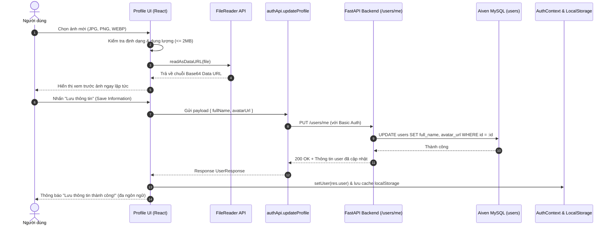
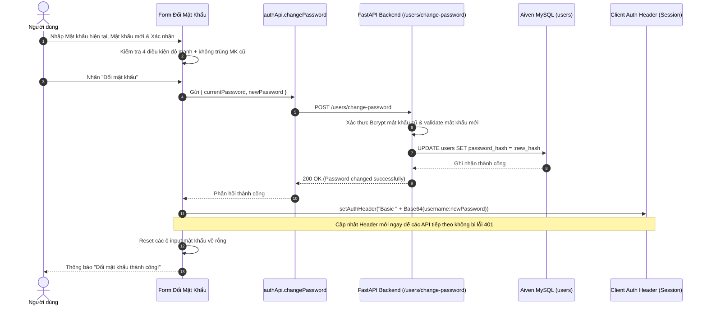

# Hướng Dẫn Chi Tiết Mã Nguồn & Luồng Hoạt Động Của Trang Hồ Sơ (Profile)

Tài liệu này giải thích chi tiết cấu trúc, nguyên lý hoạt động, các hàm xử lý và luồng dữ liệu (Data Flow) của file:
`frontend/src/app/dashboard/profile/page.tsx` trong hệ thống **FireGuard**.

---

## 1. Tổng Quan Kiến Trúc & Vai Trò Của Trang Profile

Trang **Profile** đảm nhận 4 nhiệm vụ chính trong ứng dụng:
1. **Quản lý thông tin cá nhân & Ảnh đại diện (Avatar):** Cập nhật họ tên và ảnh đại diện, đồng bộ trực tiếp với cơ sở dữ liệu MySQL thông qua FastAPI Backend và bộ nhớ đệm `localStorage`.
2. **Cài đặt giao diện hiển thị (Theme System):** Chuyển đổi giữa chế độ Sáng (Light), Tối (Dark) hoặc Theo hệ điều hành (System Default).
3. **Hiển thị quyền hạn tài khoản (RBAC Matrix):** Thể hiện trực quan các tính năng tài khoản được phép thực hiện dựa theo vai trò (`admin` hoặc `user`).
4. **Bảo mật & Phiên làm việc (Security & Session):** Đổi mật khẩu với kiểm tra quy chuẩn độ mạnh thời gian thực, tự động cập nhật lại thông tin xác thực (`Basic Auth Header`) để giữ phiên làm việc liên tục không bị gián đoạn, và làm mới `Stream Token` phục vụ xem trực tiếp luồng camera an toàn.

---

## 2. Sơ Đồ Luồng Hoạt Động (Flow Diagrams)

### 2.1. Luồng Cập Nhật Hồ Sơ & Ảnh Đại Diện



---

### 2.2. Luồng Đổi Mật Khẩu & Duy Trì Phiên Đăng Nhập



---

## 3. Chi Tiết Các Khối Mã Nguồn (Code Walkthrough)

### 3.1. Các Thư Viện & Custom Hooks Nhập Khẩu

```typescript
import React, { useState, useEffect, useRef } from 'react';
import { useAuth } from '@/context/AuthContext';       // Lấy dữ liệu user hiện tại, hàm setUser, refreshStreamToken
import { useLanguage } from '@/context/LanguageContext'; // Trích xuất từ điển dịch thuật đa ngôn ngữ (VI/EN)
import { useTheme } from '@/context/ThemeContext';       // Điều khiển theme sáng/tối
import { setAuthHeader } from '@/lib/api/client';       // Cập nhật Authorization header trong bộ nhớ
import { authApi } from '@/lib/api/auth';               // Các hàm gọi API người dùng
```

- **`useAuth()`**: Cung cấp phiên người dùng hiện tại (`user`), cho phép cập nhật lại thông tin hồ sơ trên toàn ứng dụng mà không cần tải lại trang.
- **`useLanguage()`**: Cung cấp đối tượng từ điển đa ngôn ngữ `t`. Tại component, `const p = (t.pages?.profile || {}) as Record<string, string>;` giúp lấy các nhãn hiển thị theo tiếng Anh hoặc tiếng Việt chuẩn xác.
- **`useTheme()`**: Cung cấp `theme` (chế độ người dùng chọn: `light` | `dark` | `system`) và `resolvedTheme` (chế độ thực tế đang áp dụng trên giao diện).

---

### 3.2. Quản Lý Trạng Thái (State Management)

Các state được phân chia theo từng khu vực chức năng rõ ràng:

#### A. Thông tin tài khoản & Ảnh đại diện:
```typescript
const [fullName, setFullName] = useState(user?.fullName || '');
const [avatarUrl, setAvatarUrl] = useState(user?.avatarUrl || '');
const [isProfileSaving, setIsProfileSaving] = useState(false); // Trạng thái đang gọi API lưu
const [profileMessage, setProfileMessage] = useState('');       // Thông báo kết quả lưu
const [avatarMessage, setAvatarMessage] = useState('');         // Thông báo tải/xóa avatar
const [avatarError, setAvatarError] = useState('');             // Lỗi file avatar (dung lượng/định dạng)
```

#### B. Đổi mật khẩu:
```typescript
const [password, setPassword] = useState('');               // Mật khẩu hiện tại
const [newPassword, setNewPassword] = useState('');         // Mật khẩu mới
const [confirmPassword, setConfirmPassword] = useState(''); // Nhập lại mật khẩu mới
const [showPassword, setShowPassword] = useState(false);    // Bật/tắt ẩn hiện MK cũ
const [showNewPassword, setShowNewPassword] = useState(false);
const [showConfirmPassword, setShowConfirmPassword] = useState(false);
const [isPwdSaving, setIsPwdSaving] = useState(false);
const [pwdMessage, setPwdMessage] = useState('');           // Thông báo thành công
const [pwdErrorMessage, setPwdErrorMessage] = useState(''); // Thông báo thất bại từ Backend
```

#### C. Mã kết nối Stream:
```typescript
const [isRefreshingToken, setIsRefreshingToken] = useState(false);
const [tokenMessage, setTokenMessage] = useState('');
const fileInputRef = useRef<HTMLInputElement>(null); // Điều khiển thẻ input file ẩn
```

---

### 3.3. Các Quy Tắc Tính Toán & Kiểm Tra Dữ Liệu (Computed Rules)

Trước khi cho phép người dùng nhấn các nút thao tác, mã nguồn thực hiện các kiểm tra tự động mà không cần render lại thừa thãi:

#### 1. Kiểm tra có thay đổi dữ liệu hồ sơ hay không (`isProfileChanged`):
```typescript
const initialFullName = user?.fullName || user?.username || '';
const initialAvatar = user?.avatarUrl || '';
const isProfileChanged = fullName !== initialFullName || avatarUrl !== initialAvatar;
const canSaveProfile = isProfileChanged && !isProfileSaving;
```
*Tác dụng:* Nút **"Lưu thông tin"** chỉ được kích hoạt (enabled) khi người dùng thực sự có chỉnh sửa Họ tên hoặc đổi Avatar, ngăn chặn các lệnh gọi API dư thừa.

#### 2. Đo lường độ mạnh mật khẩu (`strengthScore`):
```typescript
const rules = {
  length: newPassword.length >= 8,         // Tối thiểu 8 ký tự
  upper: /[A-Z]/.test(newPassword),        // Có ít nhất 1 chữ hoa
  lower: /[a-z]/.test(newPassword),        // Có ít nhất 1 chữ thường
  number: /[0-9]/.test(newPassword),       // Có ít nhất 1 số
};
const strengthScore = Object.values(rules).filter(Boolean).length;
```
- Khi `strengthScore < 2`: Thanh màu đỏ (Yếu).
- Khi `strengthScore` từ 2 đến 3: Thanh màu vàng (Trung bình).
- Khi `strengthScore === 4`: Thanh màu xanh lục (Mạnh).

#### 3. Điều kiện hợp lệ để đổi mật khẩu (`canSavePwd`):
```typescript
let pwdError = '';
if (confirmPassword && confirmPassword !== newPassword) {
  pwdError = p.pwdMismatch || 'Xác nhận mật khẩu mới không khớp';
} else if (newPassword && password && newPassword === password) {
  pwdError = p.pwdSameAsOld || 'Mật khẩu mới không được trùng mật khẩu cũ';
}

const canSavePwd = Boolean(
  password && newPassword && confirmPassword && strengthScore === 4 && !pwdError && !isPwdSaving
);
```
*Tác dụng:* Nút **"Đổi mật khẩu"** bị vô hiệu hóa nếu mật khẩu mới trùng mật khẩu cũ, mật khẩu xác nhận không khớp, độ mạnh chưa đạt chuẩn 4/4 hoặc đang trong tiến trình xử lý.

---

### 3.4. Vòng Đời Đồng Bộ Dữ Liệu (`useEffect`)

```typescript
useEffect(() => {
  if (user) {
    setFullName(user.fullName || user.username || '');
    const savedAvatar =
      user.avatarUrl ||
      (typeof window !== 'undefined'
        ? localStorage.getItem(`fireguard_avatar_${user.username}`) || ''
        : '');
    setAvatarUrl(savedAvatar);
  }
}, [user]);
```
- Khi đối tượng `user` được nạp từ `AuthContext`, form tự động điền họ tên hiện tại.
- Ảnh đại diện ưu tiên lấy từ backend (`user.avatarUrl`). Nếu người dùng vừa làm mới trang trong lúc mạng chập chờn, ảnh sẽ được đọc từ bộ nhớ đệm `localStorage` theo username tương ứng.

---

### 3.5. Chi Tiết Các Hàm Xử Lý Sự Kiện (Handlers)

#### 1. `handleAvatarChange`: Tải ảnh lên & chuyển đổi sang Base64
```typescript
const handleAvatarChange = (e: React.ChangeEvent<HTMLInputElement>) => {
  setAvatarError('');
  setAvatarMessage('');
  const file = e.target.files?.[0];
  if (!file) return;

  // 1. Kiểm tra định dạng tệp MIME
  if (!file.type.startsWith('image/')) {
    setAvatarError(p.avatarTypeError || 'Vui lòng chọn định dạng file ảnh hợp lệ (JPG, PNG, WEBP).');
    if (fileInputRef.current) fileInputRef.current.value = '';
    return;
  }

  // 2. Giới hạn dung lượng tối đa 2MB
  if (file.size > MAX_AVATAR_SIZE) {
    setAvatarError(p.avatarSizeError || 'Ảnh vượt quá kích thước cho phép (tối đa 2MB).');
    if (fileInputRef.current) fileInputRef.current.value = '';
    return;
  }

  // 3. Đọc tệp thành chuỗi Data URL Base64
  const reader = new FileReader();
  reader.onload = (event) => {
    const base64Url = event.target?.result as string;
    setAvatarUrl(base64Url);
    setAvatarMessage(p.avatarUpdated || 'Cập nhật ảnh đại diện thành công!');
    setTimeout(() => setAvatarMessage(''), 3000);
  };
  reader.readAsDataURL(file);
};
```

#### 2. `handleRemoveAvatar`: Xóa ảnh đại diện
```typescript
const handleRemoveAvatar = () => {
  setAvatarError('');
  setAvatarUrl('');
  if (fileInputRef.current) {
    fileInputRef.current.value = '';
  }
  setAvatarMessage(p.avatarRemoved || 'Đã xóa ảnh đại diện!');
  setTimeout(() => setAvatarMessage(''), 3000);
};
```

#### 3. `handleSaveProfile`: Lưu thông tin hồ sơ lên Backend
```typescript
const handleSaveProfile = async (e: React.FormEvent) => {
  e.preventDefault();
  if (!canSaveProfile) return;

  setIsProfileSaving(true);
  setProfileMessage('');

  try {
    // Gọi API cập nhật xuống MySQL qua FastAPI
    const res = await authApi.updateProfile({ fullName, avatarUrl });
    setUser(res.user); // Đồng bộ lại State của toàn bộ ứng dụng

    // Cập nhật bộ nhớ đệm trình duyệt
    if (typeof window !== 'undefined' && user?.username) {
      if (avatarUrl) {
        localStorage.setItem(`fireguard_avatar_${user.username}`, avatarUrl);
      } else {
        localStorage.removeItem(`fireguard_avatar_${user.username}`);
      }
    }

    // Hiển thị thông báo thành công theo ngôn ngữ hiện tại
    setProfileMessage(p.saveSuccess || 'Profile information saved successfully!');
  } catch (err: unknown) {
    const error = err as { data?: { detail?: string }; message?: string };
    setProfileMessage(error?.data?.detail || error?.message || p.saveError || 'Failed to save profile information.');
  } finally {
    setIsProfileSaving(false);
    setTimeout(() => setProfileMessage(''), 3500);
  }
};
```

#### 4. `handleSavePassword`: Đổi mật khẩu & Đồng bộ Basic Auth Header
```typescript
const handleSavePassword = async (e: React.FormEvent) => {
  e.preventDefault();
  if (!canSavePwd) return;

  setIsPwdSaving(true);
  setPwdMessage('');
  setPwdErrorMessage('');

  try {
    await authApi.changePassword({
      currentPassword: password,
      newPassword,
    });

    // Điểm mấu chốt: Cập nhật lại Authorization header ngay sau khi đổi mật khẩu
    if (user) {
      const rawCreds = `${user.username}:${newPassword}`;
      const newBasicHeader =
        'Basic ' +
        (typeof window !== 'undefined'
          ? btoa(unescape(encodeURIComponent(rawCreds)))
          : Buffer.from(rawCreds).toString('base64'));
      setAuthHeader(newBasicHeader);
    }

    setPwdMessage(p.pwdSuccess || 'Password updated successfully!');
    setPassword('');
    setNewPassword('');
    setConfirmPassword('');
  } catch (err: unknown) {
    const error = err as { data?: { detail?: string }; message?: string };
    const msg = error?.data?.detail || error?.message || p.pwdError || 'Lỗi đổi mật khẩu.';
    setPwdErrorMessage(msg);
  } finally {
    setIsPwdSaving(false);
    setTimeout(() => {
      setPwdMessage('');
      setPwdErrorMessage('');
    }, 4000);
  }
};
```
> **Tại sao cần gọi `setAuthHeader`?**
> Hệ thống backend sử dụng HTTP Basic Authentication cho các route bảo vệ. Khi mật khẩu trong cơ sở dữ liệu bị thay đổi, nếu frontend không cập nhật lại header với mật khẩu mới, tất cả các request tiếp theo (như lưu hồ sơ, lấy danh sách camera) sẽ bị Backend từ chối với mã lỗi `401 Unauthorized`. Đoạn mã trên giải quyết triệt để vấn đề này.

#### 5. `handleRefreshStreamToken`: Làm mới mã kết nối camera
```typescript
const handleRefreshStreamToken = async () => {
  setIsRefreshingToken(true);
  setTokenMessage('');

  try {
    await refreshStreamToken();
    setTokenMessage(p.streamTokenRefreshed || 'Đã làm mới mã kết nối thành công!');
  } catch {
    setTokenMessage(p.streamTokenError || 'Lỗi làm mới mã stream token.');
  } finally {
    setIsRefreshingToken(false);
    setTimeout(() => setTokenMessage(''), 3500);
  }
};
```

---

## 4. Các Khu Vực Giao Diện (UI Layout Breakdown)

Giao diện trang Profile được chia thành 4 phần trực quan:

| Phần | Nội dung | Chức năng chính |
| :--- | :--- | :--- |
| **Phần 1** | **Thông tin tài khoản** | - Xem và tải ảnh đại diện hình tròn (hỗ trợ hover camera overlay).<br>- Nhập Họ và tên (chỉnh sửa được).<br>- Tên đăng nhập và Email (chỉ đọc - `disabled`).<br>- Badge phân quyền (`Admin` hoặc `Standard User`).<br>- Trạng thái xác thực OTP Gmail. |
| **Phần 2** | **Giao diện màn hình (Theme)** | - 3 thẻ lựa chọn: **Sáng (Light)**, **Tối (Dark)**, **Hệ thống (System)**.<br>- Xem trước trạng thái hiện tại và đổi theme tức thì không giật lag. |
| **Phần 3** | **Bảng quyền hạn (RBAC Matrix)** | - Liệt kê 6 quyền hạn hệ thống:<br>  1. Xem trực tiếp camera & cảnh báo.<br>  2. Bật/tắt camera.<br>  3. Phân tích video ngoại tuyến.<br>  4. Thêm người nhận cảnh báo Telegram/Zalo.<br>  5. Quản lý camera (Chỉ Admin).<br>  6. Quản trị người dùng & Khóa tài khoản (Chỉ Admin). |
| **Phần 4** | **Bảo mật & Phiên làm việc** | - Đổi mật khẩu với nút bật/tắt hiển thị mật khẩu.<br>- Thước đo trực quan độ mạnh mật khẩu và danh sách 4 tiêu chí.<br>- Nút làm mới `Stream Token` với biểu tượng xoay `RefreshCw`. |

---

## 5. Danh Mục Đa Ngôn Ngữ (i18n Localization Keys)

Toàn bộ nhãn, thông báo thành công và thông báo lỗi được định tuyến thông qua file `frontend/src/locales/en.ts` và `frontend/src/locales/vi.ts`:

- `p.saveSuccess`: *"Profile information saved successfully!"* (EN) / *"Lưu thông tin thành công!"* (VI).
- `p.pwdSuccess`: *"Password updated successfully!"* (EN) / *"Đổi mật khẩu thành công!"* (VI).
- `p.noticeDesc`: Thông báo banner kết nối đồng bộ an toàn với cơ sở dữ liệu.
- `p.themeLight`, `p.themeDark`, `p.themeSystem`: Tên các chế độ hiển thị.
- `p.strengthWeak`, `p.strengthMedium`, `p.strengthStrong`: Đánh giá độ mạnh mật khẩu.

---

## 6. Tổng Kết

File `frontend/src/app/dashboard/profile/page.tsx` là một module hoàn chỉnh, vừa đảm bảo tính bảo mật (kiểm tra độ mạnh mật khẩu, làm sạch auth header, đồng bộ MySQL), vừa tối ưu trải nghiệm người dùng (xem trước avatar tức thì, báo lỗi thời gian thực, giao diện song ngữ mượt mà). Mã nguồn đã được chuẩn hóa TypeScript tuyệt đối, không có cảnh báo ESLint và tuân thủ các quy chuẩn kiến trúc của dự án FireGuard.
